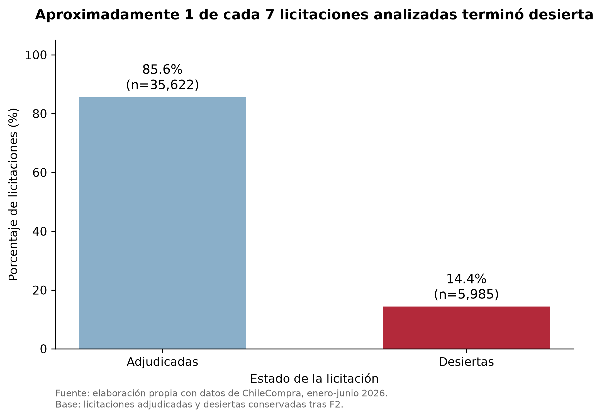
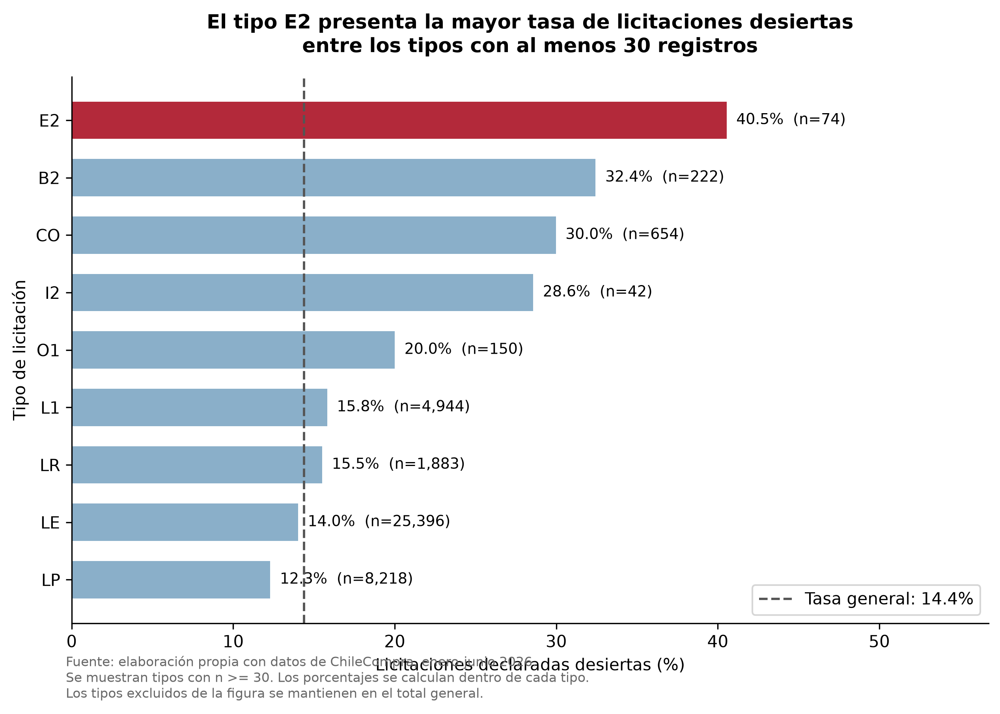
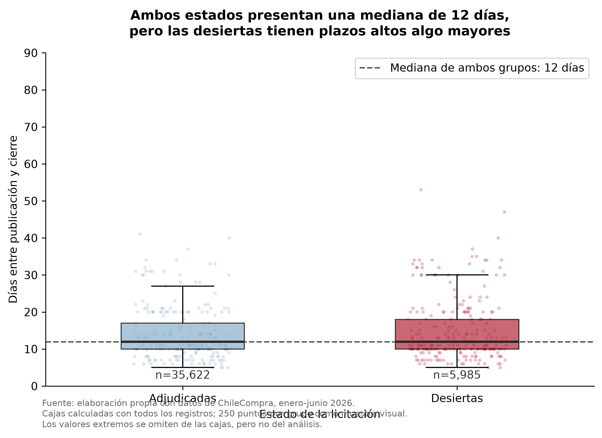

# Análisis de factores asociados a licitaciones públicas desiertas en Chile

**MCDI500 · Programación para la Ciencia de Datos**  
Magíster en Ciencia de Datos e Inteligencia Artificial · Universidad Andrés Bello  
**Equipo 1**  
**Período analizado:** enero–junio de 2026

> **Alcance:** análisis descriptivo de las licitaciones adjudicadas y declaradas desiertas conservadas tras el preprocesamiento. Los resultados no establecen causalidad ni representan necesariamente la totalidad de los procesos de compra pública de Chile.

## Contenido

1. [Descripción y objetivos](#1-descripción-y-objetivos)
2. [Resultados principales](#2-resultados-principales)
3. [Estructura del repositorio](#3-estructura-del-repositorio)
4. [Datos y procedencia](#4-datos-y-procedencia)
5. [Requisitos e instalación](#5-requisitos-e-instalación)
6. [Ejecución por fases](#6-ejecución-por-fases)
7. [Arquitectura y transformaciones](#7-arquitectura-y-transformaciones)
8. [Pruebas y eficiencia](#8-pruebas-y-eficiencia)
9. [Visualizaciones de F4](#9-visualizaciones-de-f4)
10. [Reproducibilidad y limitaciones](#10-reproducibilidad-y-limitaciones)
11. [Trazabilidad y contribuciones](#11-trazabilidad-y-contribuciones)
12. [Referencias y recursos](#12-referencias-y-recursos)

## 1. Descripción y objetivos

El proyecto examina las características de las licitaciones públicas chilenas del primer semestre de 2026 que recibieron al menos una oferta, comparando los procedimientos **adjudicados** y **desiertos**. Utiliza Python para preparar registros administrativos, validar transformaciones, evaluar eficiencia computacional y comunicar patrones mediante visualizaciones.

**Pregunta de investigación de F1:** ¿Qué características de las licitaciones publicadas durante el primer semestre de 2026, que recibieron al menos una oferta, se asocian con una mayor probabilidad de terminar declaradas desiertas frente a las adjudicadas? ¿Cómo podría utilizarse esta información para apoyar decisiones preventivas de los organismos compradores?

**Objetivos específicos establecidos en F1:**

- Identificar y caracterizar las licitaciones del período.
- Explorar, limpiar y transformar los registros, atendiendo a valores faltantes, inconsistencias y duplicados.
- Comparar las licitaciones adjudicadas y desiertas según monto, plazos, tipo, sector y región, cuando los datos lo permitan.
- Identificar patrones descriptivos que orienten recomendaciones, reconociendo sus limitaciones.

## 2. Resultados principales

La base analítica filtrada utilizada en F4 contiene **41.607 licitaciones** y **18 columnas**. Estas cifras corresponden al conjunto conservado luego de las reglas de preparación de F2.

| Indicador | Resultado |
|---|---:|
| Licitaciones adjudicadas | 35.622 (85,6 %) |
| Licitaciones desiertas | 5.985 (14,4 %) |
| Tipo E2: tasa desierta | 40,54 % (n = 74) |
| Tipo B2: tasa desierta | 32,43 % (n = 222) |
| Tipo CO: tasa desierta | 29,97 % (n = 654) |
| Mediana de días publicación–cierre, adjudicadas | 12 días |
| Mediana de días publicación–cierre, desiertas | 12 días |

**Interpretación:** los tipos presentan tasas descriptivas diferentes, pero sus tamaños de muestra también difieren. Ambos estados presentan la misma mediana de plazo, con gran superposición entre distribuciones. Ninguna de estas comparaciones demuestra una relación causal.

## 3. Estructura del repositorio

```text
proyecto-grupo_1-mcdi500/
├── F1/
│   └── notebooks/
│       └── F1_Definición.ipynb
├── F2/
│   ├── data/processed/
│   └── notebooks/
│       └── Exploración_de_datos.ipynb
├── F3/
│   ├── docs/bitacora.md
│   ├── notebooks/
│   │   ├── Revision_imputacion.ipynb
│   │   └── S2_F3_NucleoAlgoritmico.ipynb
│   ├── src/
│   │   ├── carga.py
│   │   ├── preparacion.py
│   │   ├── transformadores.py
│   │   ├── pipeline.py
│   │   ├── fabrica.py
│   │   └── medicion.py
│   └── tests/
│       ├── conftest.py
│       ├── test_carga.py
│       ├── test_transformadores.py
│       ├── test_pipeline_factory.py
│       └── test_procesamiento.py
├── F4/
│   ├── F4_Analisis_Visualizaciones.ipynb
│   └── resultados/
│       ├── grafico_1_estados.png
│       ├── grafico_2_tipos.png
│       └── grafico_3_plazos.png
├── src/
│   └── procesamiento.py
├── requirements.txt
├── changelog.md
└── README.md
```

## 4. Datos y procedencia

El procesamiento se basa en registros de licitaciones atribuidos a **ChileCompra / Mercado Público** para enero–junio de 2026. El archivo original contiene potencialmente múltiples filas por `CodigoExterno`; F2 consolida los registros para trabajar a nivel de licitación.

**Archivo original:** `F1/data/raw/licitaciones_enero_junio_2026.zip` (no versionado en Git por superar los 100 MB).

| Parámetro | Detalle de Procedencia Oficial |
|---|---|
| **Entidad oficial** | Dirección de Compras y Contratación Pública (ChileCompra) |
| **Plataforma** | Mercado Público — Datos Abiertos |
| **Portal web** | https://www.chilecompra.cl/datos-abiertos/ |
| **Descarga de datos** | https://datosabiertos.chilecompra.cl/ |
| **Período de licitaciones** | 01 de enero de 2026 al 30 de junio de 2026 |
| **Fecha de descarga** | 18 de noviembre de 2026 |
| **Huella digital (SHA-256)** | `51dcfb421968c3e66111809dd76a70f7ecff16fa31915adc752285a4a5d65232` |
| **Copia de respaldo académica** | [Enlace Google Drive](https://drive.google.com/file/d/1rlzN_3OmS7v3z6Yaiw5jbf3qjrGtuFI1/view?usp=sharing) |

**Datos preparados incluidos en el repositorio:** `F2/data/processed/`, entre ellos:

- `licitaciones_filtradas_provisional.csv.gz`: conjunto interpretable utilizado por F4.
- `matriz_filtrada_provisional.csv.gz`: matriz transformada empleada en verificaciones de F3.
- `registros_pendientes_revision.csv`: registros apartados para revisión.
- `resumen_final_f2.csv`: resumen del proceso de preparación.

La disponibilidad de los archivos procesados permite ejecutar **F3 y F4 sin repetir F2**. Para reconstruir toda la preparación desde los registros originales se requiere el archivo de origen y ejecutar F2.

## 5. Requisitos e instalación

**Entorno de desarrollo de referencia:** Python 3.13. Las versiones fijadas en `requirements.txt` de esta rama son:

| Paquete | Versión |
|---|---|
| pandas | 3.1.0 |
| numpy | 2.5.4 |
| scikit-learn | 1.9.1 |
| matplotlib | 3.11.2 |
| jupyterlab | 4.6.5 |
| gdown | 6.5.1 |
| pytest | 8.3.4 |

### Clonar el repositorio

```bash
git clone https://github.com/IgnacioCardenass/proyecto-grupo_1-mcdi500.git
cd proyecto-grupo_1-mcdi500
```


### Opción A: entorno Conda (Windows)

```bat
conda create -n MCDI500 python=3.13 -y
conda activate MCDI500
python -m pip install -r requirements.txt
python -m pip check
```

### Opción B: entorno virtual estándar (Windows CMD)

```bat
python -m venv .venv
.venv\Scripts\activate
python -m pip install -r requirements.txt
python -m pip check
```

Utilizar **una** de las dos opciones y seleccionar el mismo entorno como kernel de Jupyter en VS Code.

## 6. Ejecución por fases

| Fase | Archivo principal | Propósito |
|---|---|---|
| F1 | `F1/notebooks/F1_Definición.ipynb` | Problema, objetivos, supuestos y alcance |
| F2 | `F2/notebooks/Exploración_de_datos.ipynb` | Lectura, validación, limpieza, consolidación y exportación |
| F3 | `F3/notebooks/S2_F3_NucleoAlgoritmico.ipynb` | Pipeline, POO, validaciones y mediciones de eficiencia |
| F4 | `F4/F4_Analisis_Visualizaciones.ipynb` | Análisis descriptivo, tres figuras y conclusiones por gráfico |

**Para reproducir F3 y F4 con los datos preparados del repositorio:**

1. Instalar las dependencias desde la raíz del repositorio.
2. Abrir el notebook correspondiente en VS Code o JupyterLab.
3. Seleccionar el kernel del entorno instalado.
4. Ejecutar **Restart Kernel → Run All** y verificar las salidas.

**Para ejecutar F2 desde el origen:** primero colocar el ZIP original en `F1/data/raw/`, sin descomprimir manualmente, y seguir el flujo del notebook F2. El dataset original no se distribuye en este repositorio.

**Nota sobre rutas:** el notebook F4 busca la raíz del proyecto y carga `F2/data/processed/licitaciones_filtradas_provisional.csv.gz`. Conservar la estructura de carpetas del repositorio.

## 7. Arquitectura y transformaciones

La preparación compartida de F2 se organiza en `src/procesamiento.py`, con funciones de validación estructural, lectura por bloques, consolidación, normalización de montos y separación de registros que requieren revisión.

El núcleo de F3 separa responsabilidades:

| Módulo | Responsabilidad |
|---|---|
| `carga.py` | Cargar archivos y manejar errores de lectura |
| `preparacion.py` | Construir variables derivadas y objetivo |
| `transformadores.py` | Definir `Transformador`, `ImputadorMediana` y `CodificadorNominal` |
| `pipeline.py` | Componer y ejecutar transformaciones en secuencia |
| `fabrica.py` | Crear transformadores mediante el patrón **Factory** |
| `medicion.py` | Comparar alternativas y medir tiempo y memoria |

**POO:** las clases hijas heredan el contrato de `Transformador`; `Pipeline` invoca una interfaz común (polimorfismo), mantiene una composición de pasos y utiliza parámetros internos aprendidos durante el ajuste (encapsulamiento). La división funcional y la iteración se prefieren a introducir recursividad sin una necesidad algorítmica.

La imputación y la codificación se aplican de forma reproducible. Para evaluación predictiva futura, todo parámetro aprendido debe ajustarse exclusivamente con el conjunto de entrenamiento, evitando fuga de información.

## 8. Pruebas y eficiencia

### Pruebas automatizadas

Desde la raíz del repositorio:

```bash
python -m pytest F3/tests -v
```

Las pruebas cubren carga, imputación, casos límite, excepciones, creación de transformadores, composición del pipeline y normalización de montos. El número de pruebas puede variar con el historial de la rama; se debe registrar la salida real de `pytest` al realizar la validación final.

El notebook F3 también compara la matriz obtenida por el pipeline contra la referencia preparada en F2 mediante `pd.testing.assert_frame_equal()`.

### Eficiencia temporal y espacial

Se comparan `Series.apply()` y una implementación vectorizada para construir `EsDesierta`, comprobando antes su equivalencia. Se realizaron mediciones con **1.000, 5.000, 10.000, 20.000 y 40.000 registros**, mediante `timeit` y `tracemalloc`.

En una ejecución local sobre 40.000 registros se observaron estos resultados:

| Implementación | Tiempo observado | Pico registrado con `tracemalloc` |
|---|---:|---:|
| `apply()` | 14,012 ms | 3,13 MB |
| Vectorizada | 1,258 ms | 0,46 MB |

La vectorización fue aproximadamente **11,1 veces más rápida** en esa medición. Ambas alternativas tienen crecimiento temporal compatible con **O(n)** para la operación comparada. Las mediciones son dependientes del entorno; `tracemalloc` no equivale a memoria total del proceso.

## 9. Visualizaciones de F4

Se utiliza el dataset **interpretable** (con categorías y unidades originales) en lugar de graficar directamente la matriz One-Hot de F3. Las figuras se generan y exportan a 300 DPI en `F4/resultados/` al ejecutar el notebook.

### Figura 1. Distribución por estado



**Hallazgo:** el 14,4 % de las 41.607 licitaciones conservadas terminó desierta. Es una tasa del conjunto analítico seleccionado, **no** una estimación de todas las licitaciones chilenas.

### Figura 2. Tasa de desiertas por tipo



**Hallazgo:** E2 presenta la mayor tasa entre los tipos mostrados (40,54 %; n = 74). La figura incluye tipos con **al menos 30 registros** y señala los tamaños por categoría; el umbral es descriptivo, no una garantía de precisión estadística. Los tipos omitidos de la figura permanecen en los totales generales.

### Figura 3. Plazos entre publicación y cierre



**Hallazgo:** ambos estados presentan una **mediana de 12 días**. Las medias son 13,98 días (adjudicadas) y 14,60 días (desiertas); las distribuciones se superponen ampliamente. Las cajas utilizan todas las observaciones, mientras que los puntos muestran una muestra aleatoria reproducible de 250 por estado.

Las visualizaciones describen asociaciones y diferencias observadas; **no prueban causalidad** ni controlan simultáneamente todos los factores de confusión.

## 10. Reproducibilidad y limitaciones

- **F2:** se realizó una prueba local con un clon independiente, un entorno Conda nuevo y una copia del ZIP original; el procedimiento de obtención oficial del archivo aún requiere documentación completa.
- **F3:** se comprobó localmente la ejecución en un clon independiente con las dependencias instaladas; la suite de pruebas se ejecutó correctamente en ese contexto.
- **F4:** el notebook se ejecutó localmente de inicio a fin y generó sus tres PNG; queda pendiente verificar toda la versión final integrada en `main` desde un clon limpio.

Limitaciones sustantivas: período restringido a enero–junio de 2026; inclusión de licitaciones con ofertas y estados seleccionados; registros apartados durante la limpieza; posibles errores administrativos y valores faltantes; monedas distintas que no deben mezclarse sin conversión documentada; tamaños desiguales por categoría; y ausencia de diseño causal.

## 11. Trazabilidad y contribuciones

El archivo [`changelog.md`](changelog.md) registra fecha, descripción, justificación técnica y commits verificables para las mejoras de F1 a F4.

La colaboración se documenta en el [historial de commits](https://github.com/IgnacioCardenass/proyecto-grupo_1-mcdi500/commits/main) y en las solicitudes de integración (*Pull Requests*). Las contribuciones pueden contrastarse con la autoría de cada commit; no deben inferirse exclusivamente de quién realizó la integración.

## 12. Referencias y recursos

- [Dirección de Compras y Contratación Pública (ChileCompra)](https://www.chilecompra.cl/).
- [Mercado Público](https://www.mercadopublico.cl/).
- [Documentación oficial de Python](https://docs.python.org/3/).
- [Documentación de pandas](https://pandas.pydata.org/docs/).
- [Documentación de Matplotlib](https://matplotlib.org/stable/).
