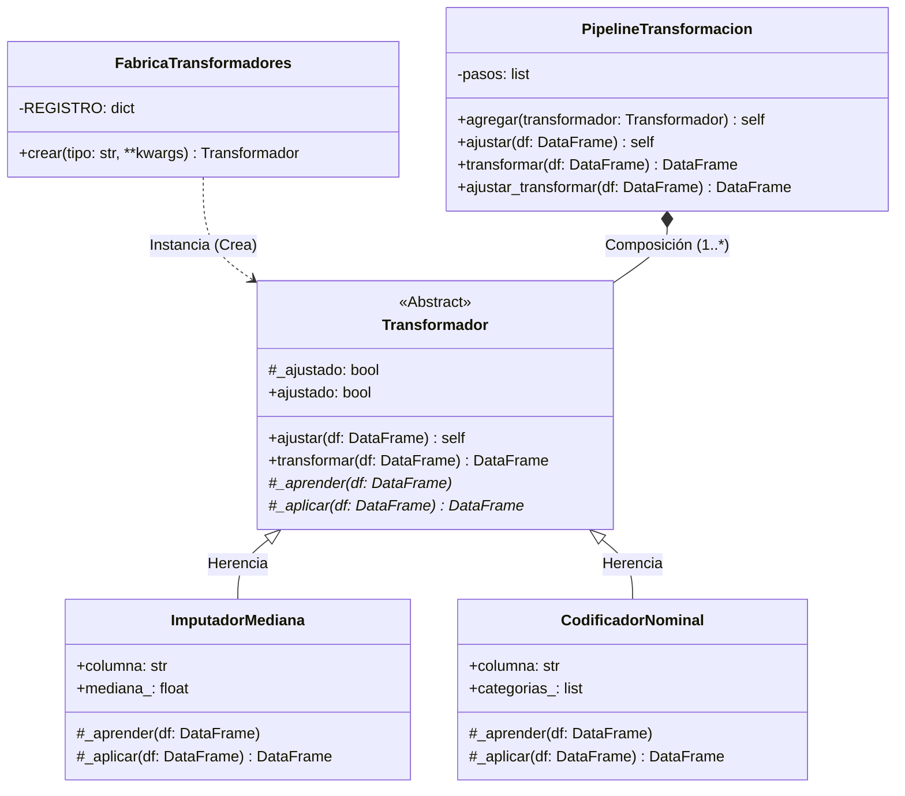

# Documentación de Arquitectura Orientada a Objetos (F3 - F4)

**MCDI500 · Programación para la Ciencia de Datos**  
**Grupo N° 1**

Este documento contiene la arquitectura formal de clases, el diagrama de diseño UML, la tabla de responsabilidades y los extractos de código comentados para incorporar directamente en el Informe Técnico Final en Word/PDF.

---

## 1. Diagrama de Clases UML (Patrón Template Method y Factory)



---

## 2. Tabla de Responsabilidades y Principios de Diseño

| Componente | Rol en la Arquitectura | Principio POO / Patrón Aplicado | Justificación Técnica |
| :--- | :--- | :--- | :--- |
| **`Transformador`** | Clase base abstracta. Define el flujo obligatorio de dos fases: aprendizaje y aplicación. | **Encapsulamiento y Template Method** | Impide transformar datos sin previo ajuste (`_ajustado == True`), evitando estados inconsistentes o fuga de datos. |
| **`ImputadorMediana`** | Especialización para rellenar valores faltantes con la mediana en pesos chilenos. | **Herencia y Polimorfismo** | Especializa `_aprender` calculando la mediana y `_aplicar` rellenando nulos, manteniendo la misma interfaz de `Transformador`. |
| **`CodificadorNominal`** | Especialización para transformar variables categóricas en indicadoras One-Hot. | **Herencia y Encapsulamiento** | Aprende las categorías del conjunto de ajuste y rechaza categorías desconocidas en datos nuevos. |
| **`FabricaTransformadores`** | Punto centralizado de instanciación de transformadores. | **Patrón de Diseño Factory** | Desacopla al pipeline de las clases concretas. Permite agregar nuevos transformadores sin modificar el código del cliente. |
| **`PipelineTransformacion`** | Orquestador que ejecuta la secuencia de transformaciones en orden. | **Composición y Polimorfismo** | Contiene una lista de objetos `Transformador` genéricos; ejecuta el preprocesamiento sin importar qué clase específica es cada paso. |

---

## 3. Extractos de Código Clave (Listos para el Informe en Word)

> **Nota para el informe:** Pegar estos bloques en Word usando fuente monoespaciada (Consolas o Courier New, tamaño 9 pt) con fondo gris claro `#F4F4F4`.

### A. Clase Base con Ciclo Template Method y Encapsulamiento
```python
class Transformador:
    """Clase base que define el ciclo de vida estricto: ajustar -> transformar."""

    def __init__(self):
        self._ajustado = False

    @property
    def ajustado(self):
        """Propiedad de solo lectura para consultar el estado de ajuste."""
        return self._ajustado

    def ajustar(self, df):
        """Aprende parámetros sobre el conjunto de datos."""
        self._aprender(df)
        self._ajustado = True
        return self

    def transformar(self, df):
        """Aplica la transformación aprendida. Falla si no fue ajustado."""
        if not self._ajustado:
            raise RuntimeError("Debe ejecutar ajustar() antes de transformar().")
        return self._aplicar(df)

    def _aprender(self, df):
        raise NotImplementedError

    def _aplicar(self, df):
        raise NotImplementedError
```

### B. Patrón Factory con Registro Desacoplado
```python
class FabricaTransformadores:
    """Fábrica que centraliza la creación de transformadores mediante registro."""

    _REGISTRO = {
        "ImputadorMediana": ImputadorMediana,
        "CodificadorNominal": CodificadorNominal,
    }

    @classmethod
    def crear(cls, tipo, **kwargs):
        """Instancia el transformador solicitado a partir de su identificador."""
        if tipo not in cls._REGISTRO:
            raise ValueError(f"Tipo de transformador desconocido: {tipo}")
        clase_transformador = cls._REGISTRO[tipo]
        return clase_transformador(**kwargs)
```

### C. Pipeline por Composición Polimórfica
```python
class PipelineTransformacion:
    """Compone una secuencia de transformadores y los ejecuta en cadena."""

    def __init__(self):
        self.pasos = []

    def agregar(self, transformador):
        self.pasos.append(transformador)
        return self

    def ajustar_transformar(self, df):
        datos = df.copy()
        for transformador in self.pasos:
            datos = transformador.ajustar(datos).transformar(datos)
        return datos
```